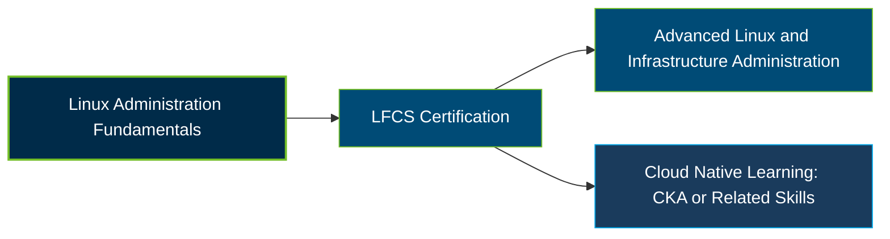

# Linux Foundation Certified System Administrator (LFCS) Certification Exam Guide

A dedicated, comprehensive study guide and system administration reference repository for candidates preparing for the **Linux Foundation Certified System Administrator (LFCS) Certification Exam**.

---

## Exam Overview

The LFCS certification validates practical Linux system administration skills, including configuring systems, managing services, troubleshooting issues, and operating Linux environments through command-line tasks.

- **Exam Format**: Online, remotely proctored, performance-based Linux command-line exam
- **Target Audience**: Linux system administrators, infrastructure engineers, operations professionals, and aspiring system administrators
- **Prerequisites**: None

---

## Core Exam Domains & Knowledge Areas

### 1. Operations and Deployment

- Configure kernel parameters, manage processes, services, and scheduled jobs.
- Install and maintain software packages and recover from system or filesystem failures.
- Manage virtual machines, containers, and SELinux security controls.

### 2. Networking

- Configure IPv4, IPv6, hostname resolution, and system time synchronization.
- Manage OpenSSH, packet filtering, NAT, static routes, bridges, and bonding.
- Monitor and troubleshoot networking, reverse proxies, and load balancers.

### 3. Storage

- Configure logical volumes, filesystems, virtual filesystems, and swap space.
- Manage remote filesystems, network block devices, and filesystem automounters.
- Monitor storage performance and troubleshoot filesystem issues.

### 4. Essential Commands

- Perform basic Git operations and manage system services.
- Monitor system performance, troubleshoot services, and identify resource constraints.
- Diagnose disk-space issues and work with SSL certificates.

### 5. Users and Groups

- Create and manage local user and group accounts.
- Configure personal and system-wide environment profiles and resource limits.
- Manage access control lists (ACLs) and LDAP-based user and group accounts.

---

## Certification Path

This is a suggested learning progression, not an official mandatory certification sequence.

---

## Recommended Practice & Study Resources

Combine official Linux Foundation learning materials with hands-on command-line practice and reliable technical documentation.

- **Official Linux Foundation Resources**: Review the [LFCS certification page](https://training.linuxfoundation.org/certification/linux-foundation-certified-sysadmin-lfcs/) and its current exam domains, competencies, and recommended learning path.
- **CertsGate**: Explore [LFCS certification preparation resources](https://certsgate.com/exams/linux-foundation/lfcs) for supplementary study materials and practice questions.
- **Practical Linux Administration**: Use the [Linux man-pages project](https://www.man7.org/linux/man-pages/) and a Linux practice environment to work on commands, services, users, networking, storage, and troubleshooting tasks.
